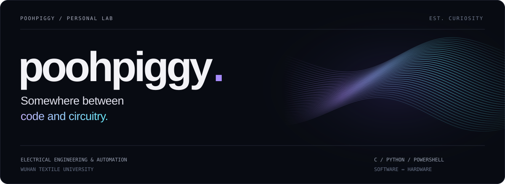

  

  <a href="https://poohpiggy.github.io/">Website</a> &nbsp; / &nbsp;
  <a href="https://github.com/poohpiggy?tab=repositories">Repositories</a> &nbsp; / &nbsp;
  <a href="https://space.bilibili.com/403805887">Bilibili</a>

 

### A little context

I'm **poohpiggy**, an Electrical Engineering & Automation student at **Wuhan Textile University**. I like taking things apart, figuring out what went wrong, and making everyday devices work a little better.

Mostly **C**, **Python**, and **PowerShell**. Lately, I've also been tinkering with Android virtual machines and writing down the fixes along the way.

 

### Selected work

<table>
<tr>
<td colspan="2" valign="top">
01 / ANDROID TINKERING
<h3><a href="https://github.com/poohpiggy/AE0.0.0.3-HyperOS4-Repair">HyperOS 4 for AE 0.0.0.3 ↗</a></h3>

Getting HyperOS 4 running inside AE: GLES rendering, the native launcher, audio, simulated calls and SMS, and app compatibility. Includes the debugging story, repair scripts, and an import package.

<a href="https://github.com/poohpiggy/AE0.0.0.3-HyperOS4-Repair">Explore the project</a> · <a href="https://github.com/poohpiggy/AE0.0.0.3-HyperOS4-Repair/blob/main/docs/troubleshooting.md">Debugging notes</a> · <a href="https://github.com/poohpiggy/AE0.0.0.3-HyperOS4-Repair/releases/tag/hyperos4-ae0.0.0.3">Download</a>

AE 0.0.0.3 · IMPORT TESTED ON K80 &amp; NEO11 · STILL A WORK IN PROGRESS
</td>
</tr>
<tr>
<td width="50%" valign="top">
02 / DEVICE AUTOMATION
<h3><a href="https://github.com/poohpiggy/AutoTouchPadCtrl">AutoTouchPadCtrl ↗</a></h3>

A lightweight PowerShell script that automatically toggles the touchpad in convertible mode on Windows Chromebooks.

POWERSHELL · WINDOWS · CHROMEBOOK
</td>
<td width="50%" valign="top">
03 / A SMALL GAME
<h3><a href="https://poohpiggy.github.io/wtumc/">WTUMC ↗</a></h3>

A visual novel I made with Ren’Py. Play it right in your browser.

REN’PY · VISUAL NOVEL · BROWSER GAME
</td>
</tr>
</table>

 

Elsewhere in the workshop

I also keep a fork of [seewoGeekWiki](https://github.com/poohpiggy/seewoGeekWiki), a community wiki around Seewo devices.

 

---

TAKE IT APART. FIGURE IT OUT. MAKE IT BETTER.

