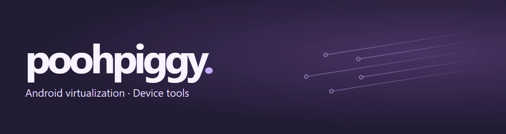

  

  <a href="https://poohpiggy.github.io/">中文主页</a> ·
  <a href="https://poohpiggy.github.io/en.html">English site</a> ·
  <a href="https://github.com/poohpiggy?tab=repositories">Repositories</a> ·
  <a href="https://space.bilibili.com/403805887">Bilibili</a>

  
  

  
  
  
  
  
  

I'm <strong>poohpiggy</strong>, an Electrical Engineering &amp; Automation student at Wuhan Textile University. I mostly work in C, Python and PowerShell. I like getting Android firmware to run in virtual machines and fixing things on the devices I use.

 

### What I'm working on

**[RedMagicEMU](https://github.com/poohpiggy/RedMagicEMU)** runs stock REDMAGIC NX809J firmware inside Android. Lately I've been working on graphics, camera support, and compatibility between the guest and host.

[Download APK](https://github.com/poohpiggy/RedMagicEMU/releases/download/0.7.0-beta/RedMagicEMU-0.7.0-beta.apk) · [0.7.0-beta release notes](https://github.com/poohpiggy/RedMagicEMU/releases/tag/0.7.0-beta) · [Firmware](https://github.com/poohpiggy/RedMagicEMU-NX809J-VM/releases/tag/11.0.21mr)

### ROMs adapted for AE

<table>
<tr>
<td width="50%" valign="top">
<h4><a href="https://github.com/poohpiggy/AE0.0.0.3-HarmonyOS4-Repair">HarmonyOS 4 for AE 0.0.0.3</a></h4>

Starry Sky theme, a reworked home screen, and simulated calls and SMS.

<a href="https://github.com/poohpiggy/AE0.0.0.3-HarmonyOS4-Repair/releases/tag/v1.1">Download</a> · <a href="https://github.com/poohpiggy/AE0.0.0.3-HarmonyOS4-Repair/blob/main/CHANGELOG.md">Changelog</a>

</td>
<td width="50%" valign="top">
<h4><a href="https://github.com/poohpiggy/AE0.0.0.3-HyperOS4-Repair">HyperOS 4 for AE 0.0.0.3</a></h4>

GLES rendering, launcher and audio fixes, and display scaling. Tested on K80 and Neo11.

<a href="https://github.com/poohpiggy/AE0.0.0.3-HyperOS4-Repair/releases/tag/hyperos4-ae0.0.0.3">Download</a> · <a href="https://github.com/poohpiggy/AE0.0.0.3-HyperOS4-Repair/blob/main/docs/troubleshooting.md">Debugging notes</a> · <a href="https://github.com/poohpiggy/AE0.0.0.3-HyperOS4-Repair/blob/main/CHANGELOG.md">Changelog</a>

</td>
</tr>
</table>

### Tools and a game

- **[ThinkPad Maintenance Utilities Kit](https://github.com/poohpiggy/ThinkPad-Maintenance-Utilities-Kit)** — Maintenance utilities for a board replacement, a bilingual guide, EFI notes, and a read-only Windows checker.
- **[AutoTouchPadCtrl](https://github.com/poohpiggy/AutoTouchPadCtrl)** — Turns off the touchpad when a Chromebook running Windows is folded into tablet mode.
- **[WTUMC](https://poohpiggy.github.io/wtumc/)** — A small Ren’Py visual novel you can play in your browser.

My everyday setup

| Device | What I use it for |
| :--- | :--- |
| **Main desktop** · Ryzen 7 9800X3D / RTX 3080 10GB / 32GB RAM | Development and running projects, mostly in WSL. |
| **NAS / Minecraft server** · Core i5-14450HX / 32GB RAM | Hosting agents and bots, plus a Minecraft server. |
| **Redmi K80** · Snapdragon 8 Gen 3 / 16GB RAM / 512GB storage | Everyday phone and AE virtual machine testing. |
| **ThinkPad L13 Gen 2** · Core i5-1135G7 / 16GB RAM | Testing on the go and remote access to my main desktop. |

I also keep a fork of [seewoGeekWiki](https://github.com/poohpiggy/seewoGeekWiki).
