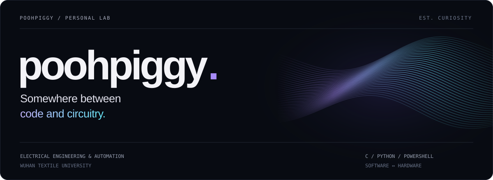

  

  <a href="https://poohpiggy.github.io/">Website</a> &nbsp; / &nbsp;
  <a href="https://github.com/poohpiggy?tab=repositories">Repositories</a> &nbsp; / &nbsp;
  <a href="https://space.bilibili.com/403805887">Bilibili</a>

 

### A little context

I'm **poohpiggy**, an Electrical Engineering & Automation student at **Wuhan Textile University**. I like taking things apart, figuring out what went wrong, and making everyday devices work a little better.

Mostly **C**, **Python**, and **PowerShell**. I maintain **RedMagicEMU**, an Android virtual-machine project focused on the REDMAGIC NX809J firmware, and have also worked on HyperOS and HarmonyOS adaptations for AE.

 

### Selected work

<table>
<tr>
<td colspan="2" valign="top">
01 / ANDROID VIRTUALIZATION
<h3><a href="https://github.com/poohpiggy/RedMagicEMU">RedMagicEMU ↗</a></h3>

Run the stock REDMAGIC NX809J Android 16 firmware on an Android device. This release adds optional Magisk Root in the Guest, improves host location sync and Vulkan compatibility, and fixes camera preview, photo orientation, and video aspect ratio.

<a href="https://github.com/poohpiggy/RedMagicEMU">Source</a> · <a href="https://github.com/poohpiggy/RedMagicEMU/releases/download/0.7.0-beta/RedMagicEMU-0.7.0-beta.apk">Download APK</a> · <a href="https://github.com/poohpiggy/RedMagicEMU/releases/tag/0.7.0-beta">Release notes</a> · <a href="https://github.com/poohpiggy/RedMagicEMU-NX809J-VM/releases/tag/11.0.21mr">Firmware</a>

REDMAGIC NX809J · ANDROID 16 / API 36 · 0.7.0-beta
</td>
</tr>
<tr>
<td colspan="2" valign="top">
02 / ANDROID TINKERING
<h3><a href="https://github.com/poohpiggy/AE0.0.0.3-HarmonyOS4-Repair">HarmonyOS 4 for AE 0.0.0.3 ↗</a></h3>

HarmonyOS 4 in AE, with the Starry Sky theme, a tailored two-page layout, and simulated calls and SMS. The package and adaptation source are available.

<a href="https://github.com/poohpiggy/AE0.0.0.3-HarmonyOS4-Repair">Explore the project</a> · <a href="https://github.com/poohpiggy/AE0.0.0.3-HarmonyOS4-Repair/releases/tag/v1.1">Download</a> · <a href="https://github.com/poohpiggy/AE0.0.0.3-HarmonyOS4-Repair/blob/main/CHANGELOG.md">Changelog</a>

AE 0.0.0.3 · PACKAGE RELEASED · CLEAN IMPORT CHECKED
</td>
</tr>
<tr>
<td colspan="2" valign="top">
03 / ANDROID TINKERING
<h3><a href="https://github.com/poohpiggy/AE0.0.0.3-HyperOS4-Repair">HyperOS 4 for AE 0.0.0.3 ↗</a></h3>

HyperOS 4 in AE, with the native launcher and GLES rendering. I worked through display issues, audio, simulated calls and SMS, browser crashes, and first-boot setup. The import package, scripts, and debugging notes are available.

<a href="https://github.com/poohpiggy/AE0.0.0.3-HyperOS4-Repair">Explore the project</a> · <a href="https://github.com/poohpiggy/AE0.0.0.3-HyperOS4-Repair/blob/main/docs/troubleshooting.md">Debugging notes</a> · <a href="https://github.com/poohpiggy/AE0.0.0.3-HyperOS4-Repair/releases/tag/hyperos4-ae0.0.0.3">Download</a> · <a href="https://github.com/poohpiggy/AE0.0.0.3-HyperOS4-Repair/blob/main/CHANGELOG.md">Changelog</a>

AE 0.0.0.3 · PACKAGE RELEASED · TESTED ON K80 &amp; NEO11
</td>
</tr>
<tr>
<td width="50%" valign="top">
04 / DEVICE AUTOMATION
<h3><a href="https://github.com/poohpiggy/AutoTouchPadCtrl">AutoTouchPadCtrl ↗</a></h3>

A small PowerShell tool for Windows Chromebooks. It turns the touchpad off in tablet mode and back on when needed. The fixes are complete.

POWERSHELL · WINDOWS · CHROMEBOOK
</td>
<td width="50%" valign="top">
05 / A SMALL GAME
<h3><a href="https://poohpiggy.github.io/wtumc/">WTUMC ↗</a></h3>

A visual novel I made with Ren’Py. Play it right in your browser.

REN’PY · VISUAL NOVEL · BROWSER GAME
</td>
</tr>
</table>

 

My everyday setup

| Device | What I use it for |
| :--- | :--- |
| **Main desktop** · Ryzen 7 9800X3D / RTX 3080 10GB / 32GB RAM | Development and running projects, mostly in WSL. |
| **NAS / Minecraft server** · Core i5-14450HX / 32GB RAM | Hosting agents and bots, plus a Minecraft server. |
| **Redmi K80** · Snapdragon 8 Gen 3 / 16GB RAM / 512GB storage | Everyday phone and AE virtual machine testing. |
| **ThinkPad L13 Gen 2** · Core i5-1135G7 / 16GB RAM | Testing on the go and remote access to my main desktop. |

 

Elsewhere in the workshop

I also keep a fork of [seewoGeekWiki](https://github.com/poohpiggy/seewoGeekWiki), a community wiki around Seewo devices.

 

---

TAKE IT APART. FIGURE IT OUT. MAKE IT BETTER.

